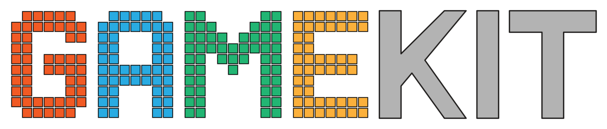

<p align="center">
  
</p>

<p align="center">
  <a href="https://github.com/bluescreen10/gamekit/actions/workflows/test.yml"></a>
  <a href="https://codecov.io/gh/bluescreen10/gamekit"></a>
</p>

GameKit is a low-level, cross-platform Go library for games and graphical tools.
It supplies native windows, input, UI controls, and a bindless GPU interface.

## Features

- Create native windows and controls with Cocoa, WinUI, or GTK 4.
- Receive portable keyboard, pointer, text, and scroll input.
- Use one UI interface on all supported platforms.
- Send graphics work to Vulkan 1.3 or Metal 4.
- Use GPU addresses and a global bindless texture heap.

The GPU design follows Sebastian Aaltonen's
[No Graphics API](https://www.sebastianaaltonen.com/blog/no-graphics-api)
proposal.

## Requirements

- Install Go 1.27 or a later compatible version.
- Enable cgo and install a C compiler for native features.
- On Linux, install the X11 and GTK 4 development files.
- Use macOS 26 or later for the Metal backend.

The Vulkan backend also needs Vulkan headers, a loader, and a compatible
driver.

## Install

Add GameKit to your Go module:

```sh
go get github.com/bluescreen10/gamekit@latest
```

## Create a window

This example creates a native window and processes its events:

```go
package main

import (
	"runtime"
	"time"

	"github.com/bluescreen10/gamekit/ui"
	_ "github.com/bluescreen10/gamekit/ui/default"
)

func main() {
	runtime.LockOSThread()

	backend, err := ui.New(nil)
	if err != nil {
		panic(err)
	}
	win, err := backend.CreateWindow(ui.WindowOptions{
		Title:     "GameKit",
		Size:      ui.Size{Width: 1280, Height: 720},
		Resizable: true,
	})
	if err != nil {
		panic(err)
	}
	defer win.Close()

	for !win.ShouldClose() {
		win.PollEvents()
		time.Sleep(time.Second / 120)
	}
}
```

The `ui/default` package registers Cocoa on macOS, Win32 on Windows, and GTK 4
on Linux. Import a backend package directly to select it by name:

```go
import (
	"github.com/bluescreen10/gamekit/ui"
	_ "github.com/bluescreen10/gamekit/ui/gtk"
)

backend, err := ui.New(&ui.Config{Backend: "gtk"})
```

Run the native UI examples:

```sh
go run ./examples/ui/widget_gallery
go run ./examples/ui/calculator
```

Linux requires the GTK 4 development package.

## Packages

| Package | Purpose |
| --- | --- |
| [`gpu`](https://pkg.go.dev/github.com/bluescreen10/gamekit/gpu) | Provides the bindless GPU interface. |
| [`gpu/vulkan`](https://pkg.go.dev/github.com/bluescreen10/gamekit/gpu/vulkan) | Implements the Vulkan backend. |
| [`gpu/metal`](https://pkg.go.dev/github.com/bluescreen10/gamekit/gpu/metal) | Implements the Metal backend. |
| [`ui`](https://pkg.go.dev/github.com/bluescreen10/gamekit/ui) | Defines the common native UI interface and layout types. |
| [`ui/default`](https://pkg.go.dev/github.com/bluescreen10/gamekit/ui/default) | Registers the default UI backend for the target platform. |
| [`ui/window`](https://pkg.go.dev/github.com/bluescreen10/gamekit/ui/window) | Implements Cocoa, Win32, and basic X11 windows. |
| [`ui/gtk`](https://pkg.go.dev/github.com/bluescreen10/gamekit/ui/gtk) | Implements GTK 4 controls on Linux. |
| [`keyboard`](https://pkg.go.dev/github.com/bluescreen10/gamekit/keyboard) | Defines portable keys and keyboard events. |
| [`pointer`](https://pkg.go.dev/github.com/bluescreen10/gamekit/pointer) | Defines portable pointer buttons and actions. |

See the [API reference](https://pkg.go.dev/github.com/bluescreen10/gamekit) for
all public types and functions.

## Test

Run all tests:

```sh
go test ./...
```

The UI conformance tests intentionally keep this command failing while UI
requirements are missing. Missing APIs fail during compilation. Implemented
APIs can still fail their behavior tests. To run the UI package tests, use:

```sh
go test ./ui -v
```

## Format

Format the Go code with `gofmt` and the C and Objective-C cgo bridges with
`clang-format`, which reads its rules from `.clang-format`:

```sh
make fmt
```

To check the formatting without changing files, use:

```sh
make fmt-check
```

Install `clang-format` with `brew install clang-format` on macOS or
`apt install clang-format` on Debian and Ubuntu. Different versions can format
the same code differently; the files are formatted with clang-format 23. To use
a different binary, set `CLANG_FORMAT`, for example
`make fmt CLANG_FORMAT=clang-format-23`.
